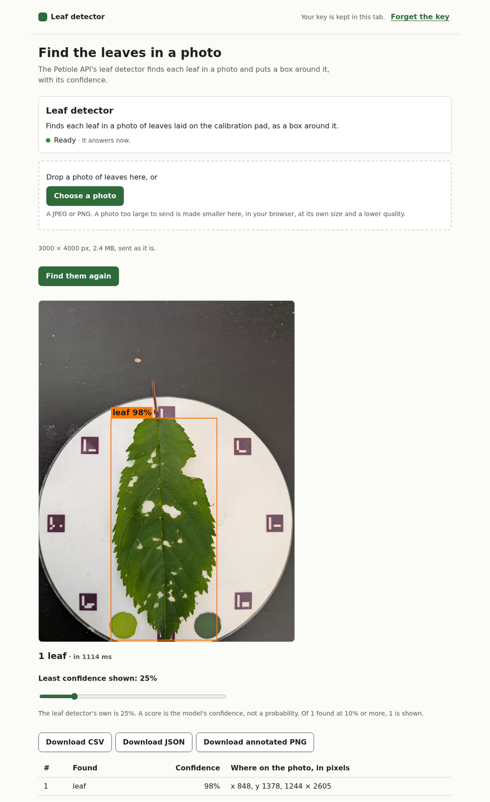

# &lt;What it does, in a few words&gt;: a Petiole API starter for the web

&lt;One sentence: what someone gets from it, on the [Petiole API](https://platform.petiole.pro).&gt;
A small, complete React app on Netlify, to copy and build your own on.

[](https://app.netlify.com/start/deploy?repository=https://github.com/getpetiole/petiole-starter-react-KIND)

## Making a starter from this skeleton

This section is the checklist of the family's conventions
(`docs/system/starters.md` in Petiole's platform repository). Tick each,
then delete the section.

- [ ] Copied into a new public repository of `getpetiole`,
      `petiole-starter-react-<kind>`, whose first commit is this skeleton
      as it is, and whose CI passed on it.
- [ ] Named: `package.json`'s `name`, `NAME` in `server/routes.ts`, the
      Deploy to Netlify link above, the page's title, header and footer.
- [ ] `server/routes.ts` lists every route the app calls, and only those;
      the contract test proves the spec has each, and that the function
      refuses every other.
- [ ] `NEEDS` in `src/App.tsx` and `.env.example` say which workflows a
      key for it needs.
- [ ] The words and the drawing: a detection as a box with its label and
      score; an outline as a filled polygon; a measurement with its unit
      from `GET /v1/object-types`; a score called the model's confidence,
      never a probability; an error in words, with the request's ID to
      quote (`src/lib/messages.ts`).
- [ ] No telemetry, no third-party scripts, no fonts from elsewhere: the
      Content Security Policy in `netlify.toml` stays as strict.
- [ ] Production only: the function calls `https://api.petiole.pro`, keys
      are `ptl_live_`.
- [ ] The README's sections below, each filled in; a picture of the app
      at work in `docs/screenshot.png`.
- [ ] `CHANGELOG.md` has the first version, and the `@petiole/sdk` version
      it was tested with; so does the README's Development section.
- [ ] Unit, contract and end-to-end tests of what the app does; CI green.
- [ ] On GitHub: a template repository ("Use this template"), its
      description and topics (`petiole`, `petiole-api`, `starter`), private
      vulnerability reporting on.
- [ ] Deployed to Netlify from the button with a key of production, and
      used end to end.

## What it does

&lt;What a visitor does, and what they get back. Plain words; what the API
calls a score is the model's confidence.&gt;



## Five minutes to a first answer

1. Make an API key on [Keys & access](https://platform.petiole.pro/keys)
   in the Petiole platform, for this app only: with &lt;the workflows it
   needs&gt; and an expiry.
2. Press **Deploy to Netlify** above. Netlify copies this repository to
   your GitHub account and builds the site, in about a minute.
3. Open the site, paste the key, and &lt;the first thing to do&gt;.

Or on your computer, with Node 24:

```sh
git clone https://github.com/getpetiole/petiole-starter-react-KIND.git
cd petiole-starter-react-KIND
npm ci
npm run dev
```

Open http://localhost:5173 and paste the key. `npm run dev` answers the
site's `/api` itself, as the Netlify Function does once deployed, so it
needs nothing but Node.

## The key

The Petiole API sends no CORS headers, and a key in a page's code can be
read by any script on the page. So the page never calls the API: it calls
the site's own function, `/api`, which calls the API with the key.

- **By default, each visitor uses their own key.** They paste it once; it
  is kept in that browser tab (`sessionStorage`), or on that device
  (`localStorage`) when they tick "Remember". It goes with each call, over
  HTTPS, to the site's function, which passes it on to Petiole and never
  stores or logs it. "Forget the key" removes it.
- **Or the site has its own key**: set `PETIOLE_API_KEY` in the site's
  environment variables on Netlify (for `npm run dev`, in `.env`, as
  `.env.example` shows), and the app no longer asks for one. Do this only
  for a site that only your own people can open, such as one behind
  Netlify's password protection: every visitor spends that key's
  allowance.

Make a key for this app alone, with only the workflows it needs and an
expiry. Your organisation's daily limits bound what any key can spend,
even one that leaks; if one does, revoke it on Keys & access, and it is
refused within a minute.

## Deploying

The **Deploy to Netlify** button makes the site from a copy of this
repository. Or make your own copy first, with **Use this template** on
GitHub, and add it to Netlify as any site from Git. `netlify.toml` holds
the rest:

- the build, `npm run build` into `dist`, on Node 24;
- the function, `netlify/functions/api.ts`, at `/api/*`;
- every page's headers, among them a strict Content Security Policy: the
  page loads nothing but its own files, and calls nothing but its own
  `/api`.

Netlify takes at most 6 MB in a request, and a photo's bytes are sent
base64-encoded, so about 4.5 MB of photo; a function may take 60 s.
&lt;How the app keeps within them.&gt;

## What it calls

The site's function forwards these routes of the Petiole API, at
`https://api.petiole.pro`, and refuses any other:

| Route | What for |
| --- | --- |
| `GET /v1/models` | The key checked, and the models it may use |

The page calls them with the Petiole TypeScript SDK,
[`@petiole/sdk`](https://www.npmjs.com/package/@petiole/sdk), pointed at
the site's `/api`. The function passes the API's answers on as they come,
its errors included; each error is shown in words, with the request's ID
to quote if you contact Petiole. It logs one line a request (the route,
the status, the time and the request's ID), never a key.

## What it does not do

&lt;What someone might expect of it that it leaves out, and where to find
it instead.&gt;

- **Keep anything.** No database, no accounts, no analytics, no
  third-party scripts. A key stays in the visitor's browser.

## Development

```sh
npm run dev            # the app, with /api, on http://localhost:5173
npm run lint
npm run typecheck
npm test               # unit tests
npm run test:contract  # through the function to a mock of the API (Prism)
npm run build
npm run e2e            # the built app in Chromium, against the mock
```

The tests never call the Petiole API. The contract and end-to-end tests
use a mock that [Prism](https://github.com/stoplightio/prism) serves from
the API's spec as released with the installed `@petiole/sdk`
(`openapi.yaml` of
[getpetiole/petiole-sdk-typescript](https://github.com/getpetiole/petiole-sdk-typescript)
at its version's tag), so a new SDK brings its spec to the tests. Last
tested with `@petiole/sdk` X.Y.Z, API v1.

## Licence

MIT. Report a vulnerability privately, as [SECURITY.md](SECURITY.md) says.
